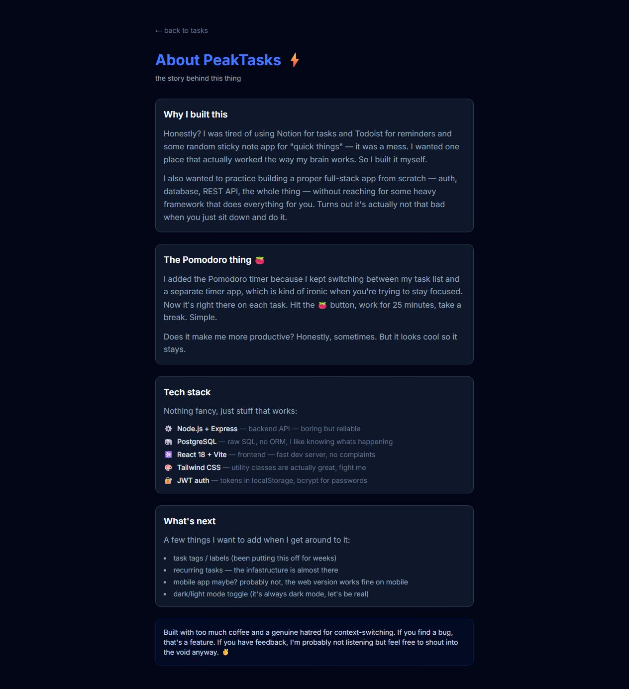

# PeakTasks

PeakTasks is a full-stack task manager with a Pomodoro timer on each task. Create and organize tasks by priority and due date, search by title, and track completed and overdue work.



The frontend uses React, Vite, and Tailwind CSS. An Express API handles authentication and stores tasks in PostgreSQL.

## Run locally

Install Node.js 20 or newer, npm, and PostgreSQL. Create a PostgreSQL database named `taskflow` that your local database user can access.

Clone the repository and start the API in one terminal.

```sh
git clone https://github.com/mmhammaden/PeakTasks.git
cd PeakTasks/taskflow/backend
npm ci
```

Copy `.env.example` to `.env` in that directory. Set `DATABASE_URL` to your PostgreSQL connection string and replace the example `JWT_SECRET` with a long, random value. Then run:

```sh
npm start
```

The API listens on port 5000 and creates its tables on startup. In a second terminal, from the repository root, start the frontend.

```sh
cd taskflow/frontend
npm ci
npm run dev
```

Open [http://localhost:5173](http://localhost:5173) and sign up to try the dashboard. Vite forwards API requests to the local backend by default, so the frontend needs no environment file for this setup.

## Offline behavior

An active Pomodoro runs in the browser while its timer stays open. Signing in and loading, creating, or updating tasks require a connection to the API. PeakTasks does not cache the app for offline startup or queue task changes for later synchronization.

See the [technical README](taskflow/README.md) for the database schema, API routes, and project structure.
